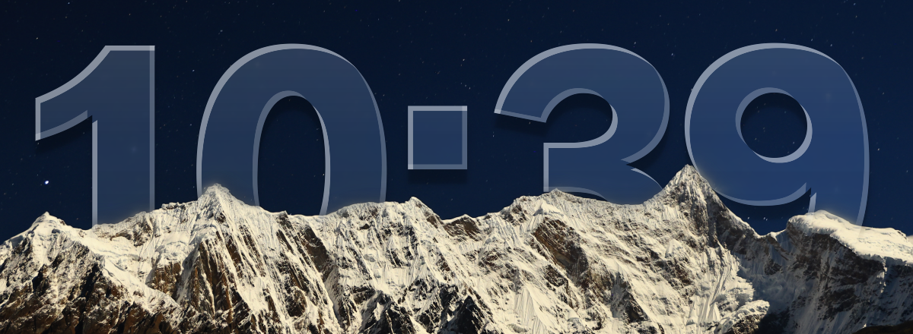
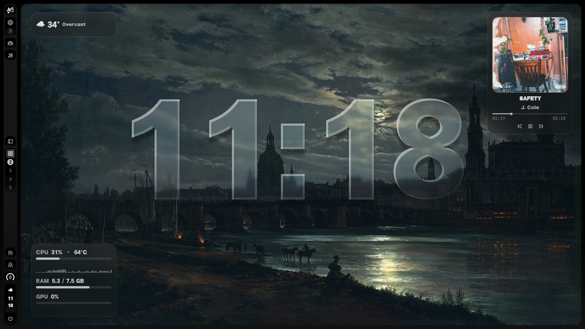

# Wallpaper Depth

A depth-effect clock for [Ambxst](https://github.com/Axenide/Ambxst): the time sits *between* your wallpaper and its foreground, so mountains, trees and buildings pass in front of it. Optionally, the clock becomes frosted liquid glass.



## Features

- **Depth effect.** A local depth model finds the foreground of each wallpaper and cuts it out; the clock is drawn behind the cutout. Switch it off and the clock simply sits on top of the wallpaper (no model needed).
- **Liquid glass style.** Toggle between solid text and a layered glass treatment with background sampling, subtle lensing, adaptive tint, angled highlights, paired edge rims and soft shadow. Frost, tint and edge light remain adjustable.
- **Auto text color.** Solid text switches between light and dark depending on how bright the wallpaper is *behind the clock*, wherever you put it.
- **Fully configurable from Settings → Mods.** Format (12/24-hour, seconds, custom), font, weight, size, text smoothing, and nine position presets with fine offsets.
- **Fast and private.** Everything runs locally. Each wallpaper is analysed once and cached.
- **Plays well with others.** Composes with [Wallpaper Transitions](https://github.com/POSiTiiiV/ambxst-mods/tree/main/packages/wallpaper-transitions) by [POSiTiiiV](https://github.com/POSiTiiiV) and [Desktop Widgets](https://github.com/And0Null/ambxst-mods/tree/main/packages/desktop-widgets) by [And0Null](https://github.com/And0Null).



*Used alongside [And0Null's Desktop Widgets mod](https://github.com/And0Null/ambxst-mods/tree/main/packages/desktop-widgets).*

## Requirements

- Ambxst `>=1.3.0 <2.0.0`
- Python 3 with `onnxruntime`, `numpy` and `pillow`
- The *Depth Anything V2 Small* model, about 99 MB in total (downloaded once, see below). Only needed for the depth effect; with it switched off, the clock still works without the model.
- Optional: `rembg` for hybrid foreground segmentation. This improves subject edges on many anime illustrations and photos; if it is absent or its models fail to load, the original depth-only pipeline is used.
- Qt 6.7 or newer for the *Smooth* text option and explicit variable-font weight-axis control. Older Qt falls back to standard text rendering and native static-face weight matching.

## Install

**1. One-time depth setup**

```
mkdir -p ~/.local/share/ambxst/depth && cd ~/.local/share/ambxst/depth
python3 -m venv venv
./venv/bin/pip install onnxruntime numpy pillow
# Optional hybrid segmentation (recommended for best cutout quality)
./venv/bin/pip install rembg
curl -L -O https://huggingface.co/onnx-community/depth-anything-v2-small-ONNX/resolve/main/onnx/model.onnx
curl -L -O https://huggingface.co/onnx-community/depth-anything-v2-small-ONNX/resolve/main/onnx/model.onnx_data
```

The model comes as **two files** that must stay side by side with exactly these names: `model.onnx` (the small graph) and `model.onnx_data` (the weights, about 99 MB). If you downloaded an older single-file `model.onnx` (about 99 MB), that works too and needs nothing else.

**2. Install the mod**

You can install the mod through pasting this directory's url to Settings →  Mods then enabling it before reloading Ambxst, or through the terminal:

```
ambxst mods install https://github.com/Rip-RGH/ambxst-mods/tree/main/packages/wallpaper-depth
ambxst mods enable rip-rgh.wallpaper-depth
ambxst reload
```

Then open **Settings → Mods → Wallpaper Depth**. The first time a wallpaper is used, the clock appears after a few seconds while the depth map is generated.

## Settings

| Setting | Default | Options | What it does |
|---|---|---|---|
| **Depth effect** | on | on / off | Draw the clock behind the wallpaper's foreground. Turn off to draw it on top of the wallpaper instead; the depth model is not needed in that case. |
| **Liquid glass style** | off | on / off | Draw the clock as layered glass instead of solid text, with sampled wallpaper, subtle lensing, adaptive tint, a diagonal sheen, edge rims and a soft shadow. |
| **Glass frost** | Medium | Clear, Light, Medium, Strong, Heavy | How blurred the wallpaper looks through the letters, from Clear to Heavy. |
| **Glass tint** | Medium | None, Light, Medium, Strong, Smoked | How strongly the glass is tinted. The tint follows Clock color, so it is light on dark wallpapers and dark on bright ones. |
| **Glass edge highlight** | Medium | Off, Soft, Medium, Bright | Strength of the specular sheen and bright/dark edge rims. |
| **Clock format** | 24-hour (14:05) | 24-hour (14:05), 24-hour with seconds (14:05:09), 12-hour (2:05 PM), 12-hour with seconds (2:05:09 PM), Custom | How the time is written. |
| **Custom format** | `HH:mm` | text | Only used when Clock format is Custom. |
| **Font** | empty | text | Name of an installed font family, for example Inter or JetBrains Mono (run fc-list : family to see what you have). |
| **Font weight** | Bold | Thin, Extra light, Light, Regular, Medium, Semi-bold, Bold, Extra bold, Black | Thickness of the clock text. SF Pro, SF Pro Display, SF Pro Text, and SF Pro Rounded use explicit named styles (Ultralight through Black) so separate installed OTF faces are selected correctly. Other variable fonts receive an explicit `wght` axis request on Qt 6.7+; static fonts use Qt’s closest available face. |
| **Text smoothing** | Smooth (recommended) | Smooth (recommended), Standard, Native | How the clock's edges are drawn. |
| **Clock size, percent of screen height** | 22 | 5 to 40 | Height of the clock text relative to the screen. |
| **Clock color** | Auto (match wallpaper) | Auto (match wallpaper), Light, Dark, Theme | Auto picks light or dark text from how bright the wallpaper is behind the clock. |
| **Clock position** | Center | Top left, Top center, Top right, Middle left, Center, Middle right, Bottom left, Bottom center, Bottom right | Where the clock sits on the screen. |
| **Horizontal offset, percent of screen width** | 0 | -50 to 50 | Moves the clock sideways from the chosen position. |
| **Vertical offset, percent of screen height** | 0 | -50 to 50 | Moves the clock up or down from the chosen position. |
| **Foreground threshold** | Balanced | Large foreground, Balanced, Small foreground, Minimal | How much of the wallpaper counts as foreground, and so can pass in front of the clock. |
| **Edge softness** | Normal | Sharp, Normal, Soft, Very soft | How soft the edge of the foreground cutout is. |

Changes apply live. Long clock formats shrink automatically to fit the screen.

**Custom format.** A Qt date/time format: `HH` hour (24h), `h` hour (12h, with `AP`), `mm` minutes, `ss` seconds, `AP` for AM/PM, `ddd` / `dddd` weekday, `d` day, `MMM` / `MMMM` month. Put literal text in single quotes. For example, `ddd d MMM HH:mm` shows "Sat 3 Oct 14:05".

**Text smoothing.** *Smooth* uses Qt's curve renderer for sharp corners and clean edges on large or very bold fonts, and draws the glass shapes at 2x. *Standard* is Qt's default renderer and can round corners on heavy fonts. *Native* uses the font's own hinting and can show colored fringes on some setups.

## How it works

1. When the wallpaper changes, `payload/depth.py` estimates relative depth with Depth Anything V2. If optional `rembg` is installed, it also estimates a general foreground mask and an anime-aware mask; the masks are averaged when both are available and used only to recover likely subject pixels near the depth cutoff. This helps with hair and detailed silhouettes without letting segmentation completely replace depth ordering. Edge-aware refinement then creates the transparent foreground PNG in `~/.cache/ambxst/depth/`. Threshold/softness changes reuse cached model outputs.
2. A QML layer (`payload/DepthLayer.qml`) stacks the clock behind that cutout, inside the wallpaper window.
3. For auto color, the script also measures the brightness of the visible background behind the clock.
4. The glass style (`payload/LiquidGlassText.qml`) is loaded only when enabled. It samples the wallpaper through the glyphs, adds a restrained pair of offset samples to suggest lensing, then layers adaptive tint, a diagonal specular sheen, bright/dark edge rims, and a soft lift shadow. It uses Qt Quick effects only, so the refraction is an approximation rather than true per-pixel lensing.

## Limitations

- Static image wallpapers only. Videos and GIFs are skipped.
- A clock placed low on the screen can be hidden by the foreground. That is the effect working as intended; use the position presets or offsets to move it.
- Foreground detection is still an estimate. Hybrid segmentation can improve hair and subject outlines, but no single mask is perfect on every anime illustration, portrait, or landscape.
- Set `AMBXST_DEPTH_SEGMENTATION=off` to force the original depth-only path, `anime` to use the anime model only, or `general` to use the general model only. The default `auto` mode tries both. The first enabled run can download model weights and take longer; subsequent masks are cached.

## Troubleshooting

- **No clock appears.** Switch *Depth effect* off: if the clock shows up, the problem is the depth setup. Check that both `~/.local/share/ambxst/depth/model.onnx` and `model.onnx_data` exist, and run `ambxst reload` in a terminal to see any `wallpaper-depth:` messages.
- **The Settings section is missing.** Reinstall the mod (`ambxst mods remove`, then install and enable again); the manager stores a snapshot at install time.
- **Font or weight not applying.** The mod logs `font not found` for names that are not installed. Use `fc-list : family style | grep -i {font-name}` to check the exact installed font family names and styles, then enter the family name shown by that command. For SF Pro families, the mod requests named styles such as Ultralight, Thin, Semibold, and Heavy directly. For other variable fonts, axis control requires Qt 6.7+; static font files use Qt’s closest matching face.
- **Glass looks faint on a bright wallpaper.** Raise *Glass tint*.

## Credits and license

[MIT licensed](LICENSE). Depth estimation uses [Depth Anything V2](https://github.com/DepthAnything/Depth-Anything-V2) (Small), in the ONNX export from [onnx-community](https://huggingface.co/onnx-community/depth-anything-v2-small-ONNX). The Small model is Apache-2.0 licensed, according to its model card. Built for the [Ambxst](https://github.com/Axenide/Ambxst) shell. The idea follows the Wallpaper Depth plugin for Noctalia Shell. Thanks to [POSiTiiiV](https://github.com/POSiTiiiV) ([Wallpaper Transitions](https://github.com/POSiTiiiV/ambxst-mods/tree/main/packages/wallpaper-transitions)) and [And0Null](https://github.com/And0Null) ([Desktop Widgets](https://github.com/And0Null/ambxst-mods/tree/main/packages/desktop-widgets)), whose mods this one is used alongside. Screenshot wallpapers belong to their respective creators.
